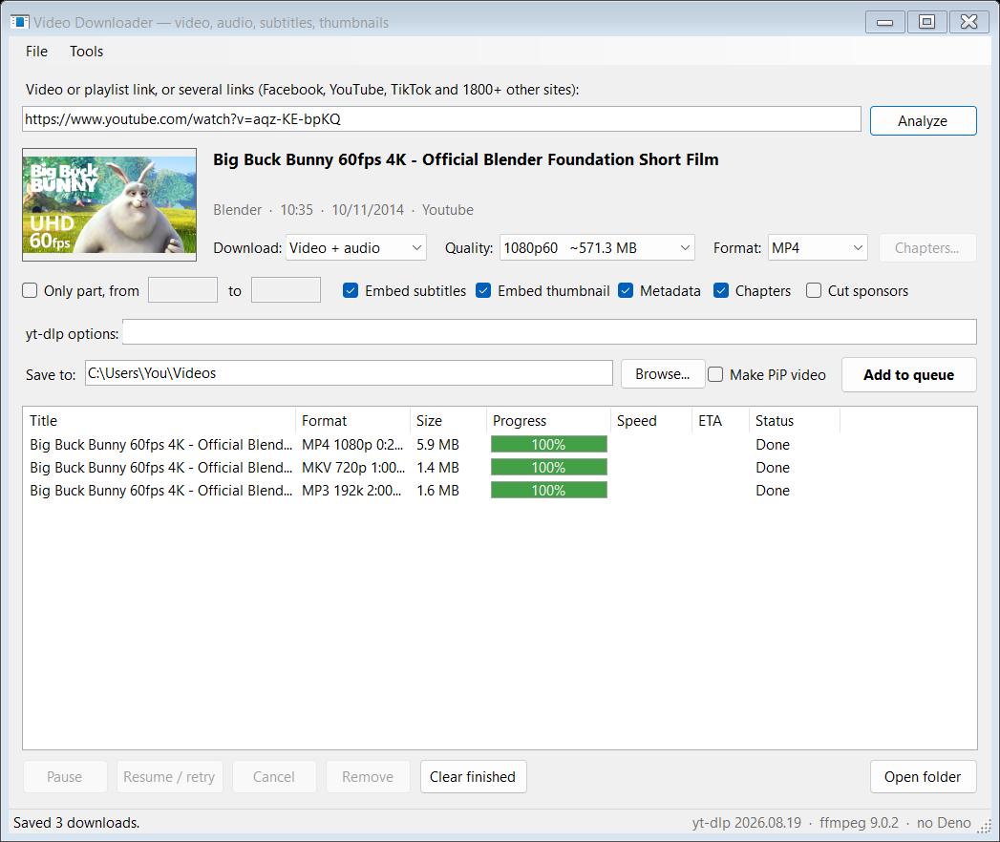
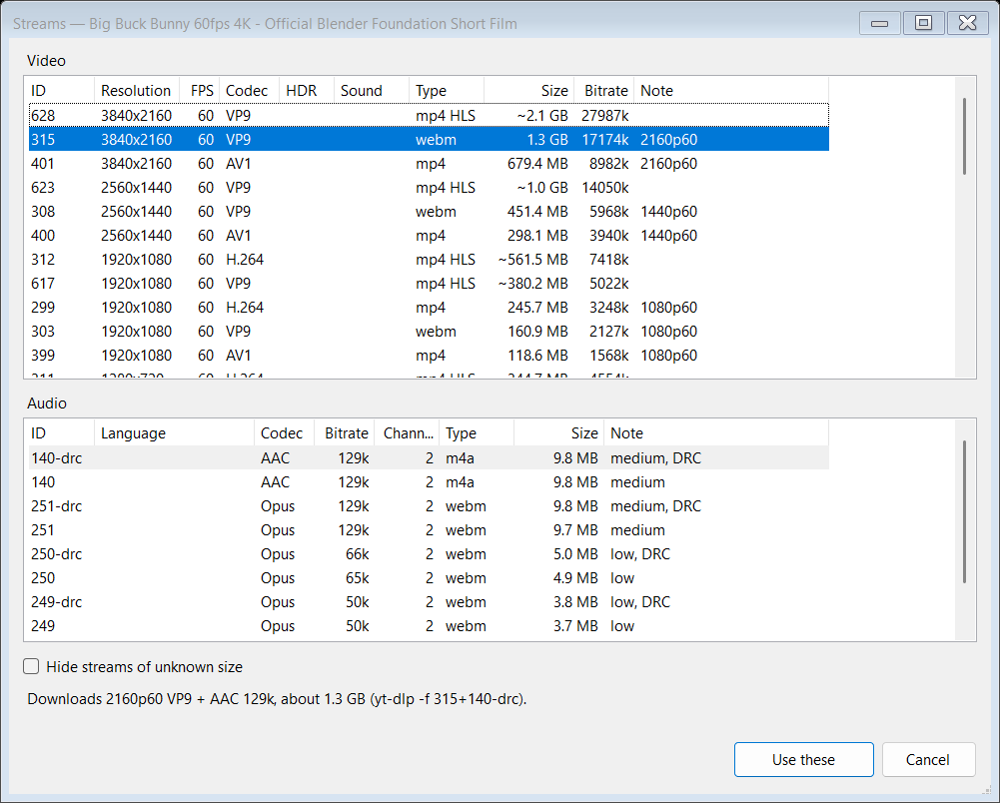

# Media Downloader

**Save videos, music, pictures, albums, subtitles and thumbnails from YouTube, Facebook, TikTok, Douyin, Bilibili, Instagram and 1800+ other sites, in the quality and format you choose.**

Paste a link, press **Analyze** to see what it has (a video and its qualities, a playlist, or a post's pictures), and press **Add to queue**. Media Downloader does the
rest: it downloads in the background, several at a time, and tells you when each one is saved.

## What it does

1. **You paste a link.** A video, a whole playlist or channel, a picture, album or post, or several links at once.
2. **You choose what to get.** Video with sound, video only, or just the sound as MP3, M4A, FLAC and more, in the
   quality you want: each quality shows its size. Or a post's or album's pictures, all of them or only the latest.
3. **It downloads in the background.** Pause, resume or cancel any download, and add more while others run.
4. **It keeps itself working.** Sites change often: the download engine (yt-dlp) updates itself each time the app
   starts, and one click updates the other tools and Media Downloader itself. Settings can switch yt-dlp to its nightly builds, which get site fixes days sooner.

## Features

| | |
|---|---|
| **1800+ sites** | YouTube, Facebook, TikTok, Douyin, Bilibili, Instagram, X, Vimeo, SoundCloud, Bandcamp and many more. |
| **Any quality** | From 144p to 4K and 8K, 60 fps and HDR when the video has them, with the size of each. |
| **Pick exact streams** | **Choose streams...** lists every video and audio stream with its codec (H.264, VP9, AV1), HDR, audio language and size. Pick a dubbed language, or a codec your TV plays. |
| **Plays everywhere** | Choose **MP4 H.264** as the format and the video plays on any TV, phone, car or video editor: a video the site only has in VP9, AV1 or HEVC (often 1440p and 4K), or in HDR, is converted after downloading. |
| **Music and audio** | Save just the sound as MP3, M4A, AAC, Opus, FLAC or WAV, at the bitrate you choose, with the cover picture. |
| **Only the part you want** | Download from one time to another, or pick **Chapters**: some of them as one file, or each to its own file named after it. |
| **Playlists and channels** | See every video in the list and tick the ones you want. Open the same playlist or channel again later and the videos you already downloaded are greyed and unticked: only the new ones are added. |
| **Pictures and posts** | Photos and whole posts too, from 300+ sites (Instagram and X photos, Pinterest, Imgur, DeviantArt, Reddit galleries...): install **gallery-dl** from the Tools menu, and links yt-dlp can't read are read with it. Or choose **Pictures and posts** to get every file of a post or profile, or only its latest posts (the last 10, 50... or the last 7, 30 days). When a post has a video and pictures, both are offered. |
| **Sign in to sites** | For private, friends-only and members-only posts and videos, and YouTube's "confirm you're not a bot": Tools > **Sign in to sites** opens Facebook, YouTube, Instagram, X, TikTok and others in a separate browser window. Sign in there once, and downloads from that site use it. Your own browser isn't touched. |
| **Your file names** | Change a download's name before adding it, or a playlist's in its list (double-click or F2). The rest are named by Settings > **File name template**, which can also sort them into folders (by channel, by date...). **File date** dates each file when it was posted, or when it was downloaded. |
| **Drag and drop** | Drop a link from your browser, a link shortcut, or a text file of links on the window: it is read at once. Drop a video or sound file from your PC, and a menu opens it in the Tools that work on it: subtitles, hashtags and summary, pictures, voice, music and sound effects, or dubbing. |
| **Files on your PC too** | The Subtitle extractor, Hashtags, description and summary, Frame extractor, Separate voice, music and sound effects and Dub into another language take a video file on your PC as well as a link: **Choose a file...**, or drop it on their window. Nothing is downloaded. |
| **Faster downloads** | Each file is downloaded over many connections at once with **aria2**, which the app adds by itself: much faster on sites that slow down each connection (Facebook, Bilibili and others). If a site refuses it, that download is tried again without it. Turn it off in Settings > Network. |
| **Network settings** | A proxy, a speed limit per download, how many parts of a streamed video come at once, and a browser to look like (Chrome, Edge, Firefox, Safari) for sites that turn away downloaders: Settings > Network. |
| **Several downloads at once** | Choose how many run at the same time; the rest wait in the queue. Close the app whenever you like: the queue comes back next time, and unfinished downloads carry on where they stopped. |
| **Live streams** | Record a live stream from its beginning or from now, or wait for one that hasn't started. Press **Stop & save** to keep what's recorded so far. |
| **Subtitles and more inside the file** | Embed subtitles in your languages, the thumbnail as cover, the title and description, and chapter marks. |
| **Burned-in subtitles** | Or draw the subtitles on the picture (Settings > Subtitles in the video), so they show on any player or site. |
| **Skip the sponsors** | On YouTube, cut out the sponsor, intro and "subscribe" parts viewers have marked. |
| **PiP video** | Also make a picture-in-picture version of a download, ready to post. |
| **Faster on your graphics card** | Converting to MP4 H.264, burning in subtitles and making PiP videos encode the whole video again: Media Downloader does it on your NVIDIA, AMD or Intel graphics card when that is faster than the processor, and on the processor otherwise. An NVIDIA card also decodes the video, which frees the processor (about 1.7 times as fast for 4K), and burns subtitles into WebM videos as AV1 (RTX 40 and newer; others make them VP9 on the processor). Files made on the card can be a little larger. Settings > **Encoding** shows what it found, and can turn it off. Downloading itself doesn't encode anything, so it doesn't need the card. The Frame extractor's one picture every few seconds is also taken on an NVIDIA card, about 3 times as fast for a 4K video. |
| **Thumbnails and subtitles on their own** | Tools > **Thumbnail saver** saves a video's cover picture, biggest first; **Subtitle extractor** saves its subtitles as SRT, VTT, ASS or LRC. From a video file on your PC, it saves the subtitles inside it (MKV, MP4) or beside it (SRT, WebVTT named after it), free even once the free days are over. |
| **Live chat archiver** | Tools > **Live chat archiver** saves a YouTube live stream's or premiere's chat replay: every message with its time, author, Super Chats and memberships. Filter it by words (or a regular expression), and save it as CSV for Excel or JSON. Double-click a message to watch that moment. |
| **Subtitles from speech** | Most TikTok, Douyin and Facebook videos have no subtitles: in the Subtitle extractor, **Make from speech** listens to what is said and writes it as SRT (or VTT, ASS, LRC): in the language spoken, or translated into English, Vietnamese or another language, with the spoken line under it if you like. From a link, or a video or sound file on your PC. It runs on your PC with whisper.cpp, nothing is sent anywhere, and several times faster on a graphics card of its own (NVIDIA, AMD or Intel Arc) when there is one; the first time it downloads the speech recognizer and a model (150 to 575 MB, by how accurate you choose), and to translate into a language other than English, a translator (about 5 GB). |
| **Hashtags, description and summary** | Tools > **Hashtags, description and summary** shows a video's hashtags, from its title, its description and the site's tags, ready to copy for your own post, and its description. **Summarize** writes what the video is about and its main points, in the language you choose (Vietnamese, English and more), from what is said in it: its own subtitles, or what the speech recognizer hears when it has none. It runs on your PC with Make from speech's translator (Qwen3 8B), nothing is sent anywhere; the first time it downloads it (about 5 GB). Save them all as a text file. A video file on your PC has its hashtags taken from its name and from the title and description inside it (Media Downloader puts them in the videos it downloads), and is summarized from the subtitles inside it or beside it, or what is said. |
| **Pictures from a video** | Tools > **Frame extractor** saves pictures from a video: one every few seconds, one at each change of scene, at the times you type, a number of them spread evenly, or every frame; of the whole video or only a part, which is all it downloads. As JPG, PNG or WebP, at the size you choose (1080p at first: 4K takes about twice as long), each named with its time in the video, and if you like a contact sheet with all of them in a grid. The pictures appear in the folder as they are made, and the ones made stay when you stop. Spread evenly reads the pictures straight from the video online, without downloading it, when they are 4 seconds apart or more; changes of scene are found in the site's smallest copy of the video when it has one (YouTube does), five times as quick for a 4K video. Every frame says first how much room the pictures take, and warns when the drive hasn't enough. Or choose a video file on your PC: the pictures are taken straight from it. Each video's pictures go in a folder named after it, unless you untick that. |
| **Voice, music and sound effects** | Tools > **Separate voice, music and sound effects** takes a video's sound apart into what is said, the background music (with its singing) and the sound effects, each to its own file (WAV, MP3, M4A or FLAC): a voice to dub over or subtitle, music without the talking, a video's sound without its music. From a link or a file on your PC. It runs on your PC with the BandIt v2 model, nothing is sent anywhere: on a graphics card of its own (NVIDIA, AMD or Intel) a minute of sound takes about a minute, on the processor several. The first time it downloads ONNX Runtime and the model (about 270 MB). |
| **Dub into another language** | Tools > **Dub into another language** makes a video speak another language: a Chinese video in Vietnamese, for example. What is said is heard and translated (as Make from speech does), each line is read by a voice at its time, a little faster where the translation is longer, over the video's own music and sound effects with its voice taken out (or its sound turned down, if you untick that), and the picture is kept as it is. The original sound stays as a second audio track you can switch to. Into Vietnamese, English, Chinese, Indonesian, French, German, Spanish, Portuguese, Italian, Russian, Arabic or Turkish. From a link or a file on your PC. It all runs on your PC, with the Piper voices, nothing is sent anywhere. The voice is a synthetic one, not the speaker's. The first time it downloads Piper and the voice (about 85 MB), besides the speech recognizer, the translator and the separator when they aren't there yet. |
| **Bilingual subtitles** | In the Subtitle extractor, tick two languages and **Bilingual**: one file shows each line in both, the language you choose on top, the other under it. For learning a language, or watching together. |
| **Browser extension** | In Chrome, Edge or Brave, one click on the extension's button sends the page you're on to the app, a video, pictures or a post (a blue arrow on the button shows when the page is a video), signed in as you are in the browser. Or right-click a link, a video or a picture and choose **Download with Media Downloader**. |
| **Copy a link, it's read** | Turn on Tools > **Watch the clipboard for links**: copy a video's or post's address in your browser and it's ready to download. |
| **Posts and videos that need a sign-in** | Send them with the browser extension, which brings your sign-in along. Or use the cookies of the browser you're signed in with (Firefox), or a cookies file, for what only members or friends can see. |
| **Told when it's done** | A notification when a download ends while the window is in the background. |
| **Its own log** | Right-click a download and choose **Show log** to see exactly what happened, to fix a problem or ask for help. |
| **Light or dark, English or Vietnamese** | Follows your Windows theme and display language, or choose them in Settings. |
| **For scripts** | `MediaDownloader.exe <link>... [--dir <folder>] [--cookies <cookies.txt>]` opens the app with the links read, saving to that folder with those cookies for that run only. |

## Choosing the exact streams

For one video, the last entry of the Quality list, **Choose streams...**, opens every stream the site has:

Pick a video stream and an audio stream, and press **Use these**. The pick shows in the Quality list and in the queue.

## Sending links from your browser

The extension for Chrome, Edge and Brave comes with the app. Add it once:

1. In Media Downloader, open **Tools > Browser extension...** and press **Open the folder**. Its path is copied too.
2. In the browser, open `chrome://extensions` (`edge://extensions` in Edge, `brave://extensions` in Brave) and turn
   on **Developer mode**.
3. Press **Load unpacked** and choose that folder (paste its path in the folder box).
4. Pin it: press the puzzle piece next to the address bar, then the pin next to Media Downloader.

Then, on a video's or post's page, click the Media Downloader button: the app opens (or comes to the front) with the
link read, ready to choose the quality and press **Add to queue**. A tick on the button says the link was sent.
Right-click a link, a video playing in the page or a picture for **Download with Media Downloader**.

Posts and videos you can only see signed in (members-only, private or age-restricted) work too: the extension sends your
browser's cookies for that site with the link, so the app is signed in as you are. When you add the extension, the
browser warns that it can "read and change all your data on all websites": that is what reading a site's cookies
needs. It sends nothing until you click, and then only the link and that one site's cookies, only to the app on your
PC. The app keeps them while it is open, uses them for that site only, and deletes them when you close it.

## Free trial

Try everything free for **30 days**, no key needed and nothing limited. The status bar shows how many days are left.
After that, Media Downloader still reads links, but downloading (videos, music, pictures, subtitles, thumbnails and chats) needs
a license key, and so do the Tools that work on a file on your PC (Make from speech, the summary, the Frame extractor,
Separate voice, music and sound effects, and Dub into another language). Saving the subtitles a file on your PC already has stays free.

## Buying a license

Open **Help > License...** (or click the license text at the right of the status bar), copy the machine code it
shows, and send it to us by email (the **Copy email** button helps). You get a license key back: paste it into the
same window and press **Register**.

Licenses are available for a period of time (for example monthly or yearly), for your PC.

## Requirements

- Windows 10 or Windows 11 (64-bit)
- An internet connection
- About 500 MB of free disk space, plus room for your downloads. The AI tools download what they need the first time
  you use one: up to about 600 MB for Make from speech, about 5 GB for translation and Summarize, about 200 MB for
  Separate voice, music and sound effects, about 85 MB for Dub into another language (about 7 GB for all of them)
- Optional: an NVIDIA, AMD or Intel graphics card with an up-to-date driver, for faster converting (see **Faster on
  your graphics card**)

## Installing

Run `MediaDownloader-<version>.exe` and follow the steps. No administrator rights are needed. Installing a new
version over the old one keeps your settings. Uninstalling deletes the sign-ins and cookies the app kept, the
download list and the record of what was downloaded, and leaves your settings, so a reinstall picks up where you left
off.

The first time it starts, Media Downloader downloads yt-dlp (about 24 MB), the engine that reads and downloads the
links, and ffmpeg (about 110 MB), which it needs to join HD video with its sound, convert audio and cut parts. The
status bar shows how far each got; it is ready to use when that is done. It then adds aria2 (about 5 MB), for faster
downloads, in the background. After that, it updates yt-dlp by itself when it starts and a new one is out.

For YouTube, the app offers to add Deno (about 45 MB) the first time you read a YouTube link: without it YouTube
gives fewer qualities, often not the best. You can also add it later from the Tools menu.

## Please note

Download only what you have the right to: your own videos, videos their owner lets you download, or what the law lets
you copy. Each site has its own terms. See the license agreement shown during setup.

Media Downloader uses yt-dlp, FFmpeg, Deno, gallery-dl, aria2, whisper.cpp, llama.cpp, ONNX Runtime, the BandIt v2 model and Piper, made by others and free to use under their own licenses: see
THIRD-PARTY-NOTICES.txt in the folder the app is installed in. FFmpeg is gyan.dev's build, the one ffmpeg.org links
to for Windows.

## Contact

- For support: **khanh1985@gmail.com**
- **Phone:** +84 985 884 764
- [Privacy policy](https://github.com/xuankhanh/MediaDownloader/blob/main/PRIVACY.md), including how to delete your data

© 2026 Truong Xuan Khanh. All rights reserved.
