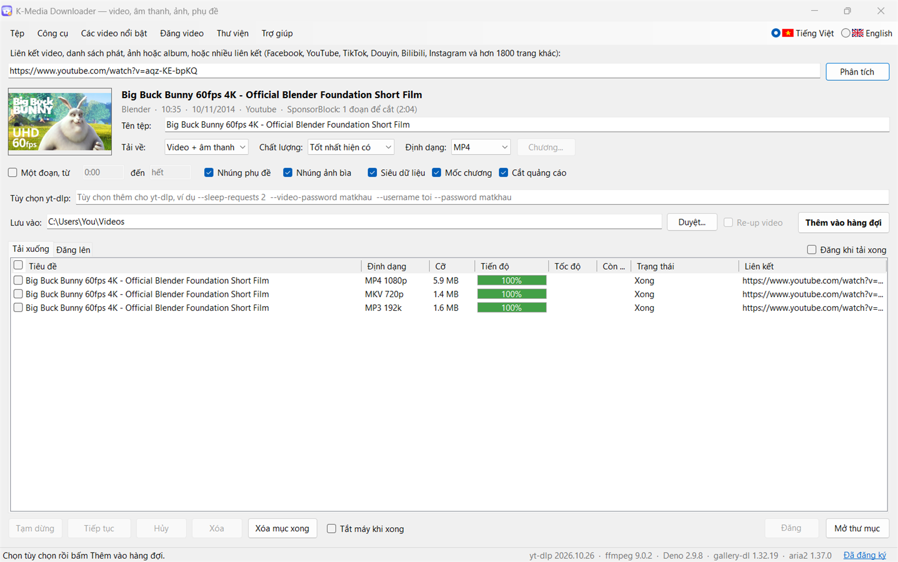
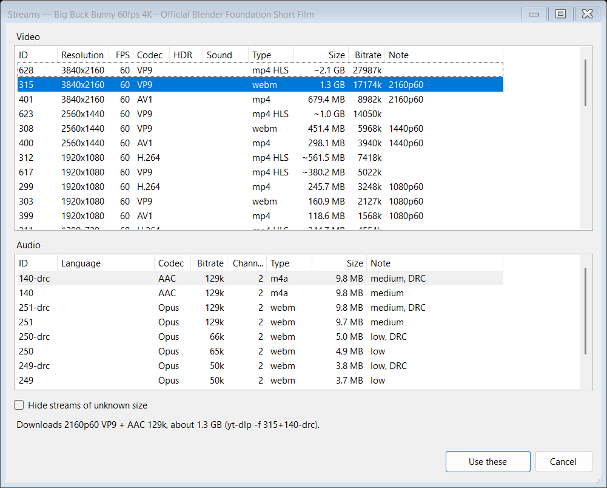

[English](https://github.com/xuankhanh/MediaDownloader/blob/main/README.md) | **Tiếng Việt**

# K-Media Downloader

**Tải video, nhạc, ảnh, album, phụ đề và ảnh bìa từ YouTube, Facebook, TikTok, Douyin, Bilibili, Instagram và hơn 1800 trang khác, với chất lượng và định dạng bạn chọn.**

Dán liên kết, bấm **Phân tích** để xem trang đó có gì (một video và các mức chất lượng, một danh sách phát, hay ảnh của một bài đăng), rồi bấm **Thêm vào hàng đợi**. K-Media Downloader lo phần còn lại: tải ngầm, nhiều video cùng lúc, và báo cho bạn khi từng video đã lưu xong.

## Phần mềm làm được gì

1. **Bạn dán một liên kết.** Một video, cả danh sách phát hoặc kênh, một ảnh, album hay bài đăng, hoặc nhiều liên kết cùng lúc.
2. **Bạn chọn thứ cần lấy.** Video có tiếng, video không tiếng, hoặc chỉ lấy tiếng thành MP3, M4A, FLAC và nhiều định dạng khác, với chất lượng bạn muốn: mỗi mức chất lượng đều hiện dung lượng. Hoặc lấy ảnh của một bài đăng hay album, tất cả hoặc chỉ những ảnh mới nhất.
3. **Tải ngầm.** Tạm dừng, tiếp tục hoặc hủy bất kỳ lượt tải nào, và thêm lượt mới khi các lượt khác đang chạy.
4. **Tự giữ cho luôn dùng được.** Các trang web hay thay đổi: công cụ tải (yt-dlp) tự cập nhật mỗi khi mở ứng dụng, và một cú bấm cập nhật các công cụ còn lại cùng chính K-Media Downloader, cửa sổ cho biết bản mới có gì. Trong Cài đặt có thể chuyển yt-dlp sang bản nightly, nhận các bản sửa lỗi cho trang web sớm hơn vài ngày.

## Tính năng

| | |
|---|---|
| **Hơn 1800 trang** | YouTube, Facebook, TikTok, Douyin, Bilibili, Instagram, X, Vimeo, SoundCloud, Bandcamp và nhiều trang khác. |
| **Mọi chất lượng** | Từ 144p đến 4K và 8K, 60 fps và HDR khi video có, kèm dung lượng của từng mức. |
| **Chọn đúng luồng** | **Chọn luồng...** liệt kê mọi luồng video và âm thanh với codec (H.264, VP9, AV1), HDR, ngôn ngữ tiếng và dung lượng. Chọn bản lồng tiếng theo ngôn ngữ, hoặc codec mà TV của bạn phát được. |
| **Phát được ở mọi nơi** | Chọn định dạng **MP4 H.264** là video phát được trên mọi TV, điện thoại, ô tô hay phần mềm dựng video: video mà trang web chỉ có ở VP9, AV1 hay HEVC (thường là 1440p và 4K), hoặc ở HDR, sẽ được chuyển đổi sau khi tải. |
| **Nhạc và âm thanh** | Chỉ lưu tiếng thành MP3, M4A, AAC, Opus, FLAC hoặc WAV, với bitrate bạn chọn, kèm ảnh bìa. |
| **Chỉ lấy đoạn bạn muốn** | Tải từ thời điểm này đến thời điểm khác, hoặc chọn **Chương**: một số chương thành một tệp, hoặc mỗi chương một tệp đặt tên theo chương. |
| **Danh sách phát và kênh** | Xem mọi video trong danh sách và tick những video bạn muốn. Mở lại cùng danh sách phát hay kênh sau này, các video đã tải sẽ bị làm mờ và bỏ tick: chỉ thêm những video mới. |
| **Ảnh và bài đăng** | Cả ảnh và nguyên bài đăng, từ hơn 300 trang (ảnh Instagram và X, Pinterest, Imgur, DeviantArt, thư viện Reddit...): cài **gallery-dl** từ menu Công cụ, và những liên kết yt-dlp không đọc được sẽ do nó đọc. Hoặc chọn **Ảnh và bài đăng** để lấy mọi tệp của một bài đăng hay trang cá nhân, hoặc chỉ các bài mới nhất (10, 50... bài gần nhất, hoặc 7, 30 ngày gần nhất). Khi một bài có cả video và ảnh, cả hai đều được đưa ra để chọn. |
| **Đăng nhập vào các trang** | Cho bài đăng và video riêng tư, chỉ bạn bè, chỉ thành viên, và cho yêu cầu "xác nhận bạn không phải robot" của YouTube: Công cụ > **Đăng nhập vào các trang** mở Facebook, YouTube, Instagram, X, TikTok và các trang khác trong một cửa sổ trình duyệt riêng. Đăng nhập ở đó một lần, các lượt tải từ trang đó sẽ dùng phiên đăng nhập này. Trình duyệt của bạn không bị đụng đến. |
| **Tên tệp theo ý bạn** | Đổi tên một lượt tải trước khi thêm, hoặc tên video trong danh sách phát (bấm đúp hay F2). Các video còn lại được đặt tên theo Cài đặt > **Mẫu tên tệp**, mẫu này còn có thể xếp tệp vào thư mục (theo kênh, theo ngày...). **Ngày của tệp** ghi ngày đăng, hoặc ngày tải của từng tệp. |
| **Kéo và thả** | Thả một liên kết từ trình duyệt, một lối tắt liên kết, hoặc một tệp văn bản chứa các liên kết vào cửa sổ: nó được đọc ngay. Thả một tệp video hay âm thanh trong máy, một menu sẽ mở nó trong các công cụ xử lý được: phụ đề, hashtag và tóm tắt, tách hình, tách giọng, nhạc và hiệu ứng, hoặc lồng tiếng. |
| **Cả tệp trong máy** | Trích xuất phụ đề, Hashtag, mô tả và tóm tắt, Tách hình từ video, Tách giọng nói, nhạc nền và hiệu ứng âm thanh, và Lồng tiếng sang ngôn ngữ khác nhận cả tệp video trong máy lẫn liên kết: **Chọn tệp...**, hoặc thả tệp lên cửa sổ của chúng. Không có gì được tải về. |
| **Tải nhanh hơn** | Mỗi tệp được tải qua nhiều kết nối cùng lúc bằng **aria2**, ứng dụng tự thêm công cụ này: nhanh hơn nhiều ở những trang làm chậm từng kết nối (Facebook, Bilibili và các trang khác). Nếu trang từ chối, lượt tải đó được thử lại mà không có aria2. Tắt trong Cài đặt > Mạng. |
| **Cài đặt mạng** | Proxy, giới hạn tốc độ cho mỗi lượt tải, số phần của một video phát trực tuyến được tải cùng lúc, và trình duyệt để giả dạng (Chrome, Edge, Firefox, Safari) cho những trang từ chối công cụ tải: Cài đặt > Mạng. |
| **Nhiều lượt tải cùng lúc** | Chọn số lượt chạy cùng một lúc, các lượt còn lại chờ trong hàng đợi. Đóng ứng dụng lúc nào cũng được: lần sau hàng đợi quay lại, và các lượt tải dở dang tiếp tục từ chỗ đã dừng. |
| **Danh sách hàng đợi và Đăng lên** | Tick các hàng (ô ở bên trái mỗi hàng, ô ở tiêu đề danh sách để tick tất cả, hoặc Ctrl+A) thì các nút bên dưới danh sách tác động lên các hàng đã tick trước; khi chưa tick hàng nào, chúng tác động lên các hàng đang chọn, còn menu chuột phải tác động lên hàng bạn bấm. **Hủy** hỏi trước khi dừng một lượt tải đã bắt đầu (các tệp đã tải dở bị xóa) hoặc một video đang được đăng, **Xóa** luôn hỏi, và **Xóa mục xong** chỉ lấy khỏi danh sách những mục đã xong, lỗi hoặc đã hủy. Bấm đúp một hàng để mở tệp hoặc bài đăng của nó. Cửa sổ mở lại ở thẻ bạn đã để. Danh sách **Đăng lên** cũng được giữ khi bạn đóng ứng dụng: những video đang chờ đăng sẽ tiếp tục ở lần mở sau, còn video đang được đăng được đánh dấu **Kiểm tra bài đã đăng chưa**, vì có thể nó đã lên trang: bạn được hỏi lại trước khi thử đăng lần nữa. |
| **Phát trực tiếp** | Ghi một buổi phát trực tiếp từ đầu hoặc từ bây giờ, hoặc chờ một buổi chưa bắt đầu. Bấm **Dừng & lưu** để giữ phần đã ghi. |
| **Phụ đề và hơn thế nữa nằm trong tệp** | Nhúng phụ đề theo các ngôn ngữ của bạn, ảnh bìa, tiêu đề và mô tả, cùng các mốc chương. |
| **Phụ đề nhúng cứng** | Hoặc vẽ phụ đề lên hình (Cài đặt > Phụ đề trong video), để nó hiện trên mọi trình phát hay trang web. |
| **Bỏ qua quảng cáo tài trợ** | Trên YouTube, cắt các phần tài trợ, phần mở đầu và lời nhắc "đăng ký kênh" mà người xem đã đánh dấu. |
| **Nhanh hơn nhờ card đồ họa** | Chuyển sang MP4 H.264, nhúng cứng phụ đề và làm video re-up (kể cả hình trong hình) đều mã hóa lại cả video: K-Media Downloader làm việc đó trên card đồ họa NVIDIA, AMD hoặc Intel khi nhanh hơn bộ xử lý, và trên bộ xử lý trong trường hợp còn lại. Card NVIDIA còn giải mã video, giúp bộ xử lý rảnh tay (nhanh gấp khoảng 1,7 lần với 4K), và nhúng cứng phụ đề vào video WebM dưới dạng AV1 (RTX 40 trở lên; các card khác tạo VP9 trên bộ xử lý). Tệp tạo trên card có thể lớn hơn một chút. Cài đặt > **Mã hóa** cho biết đã tìm thấy gì, và có thể tắt. Bản thân việc tải không mã hóa gì nên không cần card. Việc lấy một ảnh sau mỗi vài giây của Tách hình từ video cũng chạy trên card NVIDIA, nhanh gấp khoảng 3 lần với video 4K. |
| **Ảnh bìa và phụ đề riêng** | Công cụ > **Lưu ảnh thu nhỏ** lưu ảnh bìa của video, lớn nhất trước; **Trích xuất phụ đề** lưu phụ đề dưới dạng SRT, VTT, ASS hoặc LRC. Với tệp video trong máy, nó lưu phụ đề nằm trong tệp (MKV, MP4) hoặc cạnh tệp (SRT, WebVTT đặt tên theo tệp), miễn phí kể cả khi hết ngày dùng thử. |
| **Lưu chat trực tiếp** | Công cụ > **Lưu chat trực tiếp** lưu bản phát lại chat của một buổi phát trực tiếp hay buổi công chiếu YouTube: mọi tin nhắn kèm thời gian, tác giả, Super Chat và gói thành viên. Lọc theo từ (hoặc biểu thức chính quy), và lưu thành CSV cho Excel hoặc JSON. Bấm đúp một tin nhắn để xem đúng khoảnh khắc đó. |
| **Phụ đề từ giọng nói** | Phần lớn video TikTok, Douyin và Facebook không có phụ đề: trong Trích xuất phụ đề, **Tạo từ giọng nói** nghe nội dung được nói và đưa ra một menu để trích phụ đề gốc, dịch bằng mô hình AI chạy trong máy sang tiếng Anh, tiếng Việt hay ngôn ngữ khác rồi lưu thành tệp phụ đề riêng, hoặc dịch và nhúng cứng thẳng vào video. Phụ đề có thể ở phía dưới, che phụ đề cũ ở dưới bằng một dải đen, hoặc đặt ở phía trên. Từ một liên kết, hoặc một tệp video hay âm thanh trong máy. Nó chạy ngay trên máy bạn bằng whisper.cpp và Qwen3, không gửi gì đi đâu, và nhanh hơn nhiều lần khi có card đồ họa rời (NVIDIA, AMD hay Intel Arc); lần đầu nó tải bộ nhận dạng giọng nói và một mô hình (150 đến 575 MB, tùy độ chính xác bạn chọn), cùng bộ dịch (khoảng 5 GB). |
| **Hashtag, mô tả và tóm tắt** | Công cụ > **Hashtag, mô tả và tóm tắt** hiện hashtag của video, lấy từ tiêu đề, mô tả và thẻ của trang, sẵn sàng để chép dùng cho bài đăng của bạn, cùng mô tả của video. **Tóm tắt** viết ra video nói về gì và các ý chính, bằng ngôn ngữ bạn chọn (tiếng Việt, tiếng Anh và nhiều hơn), dựa trên lời nói trong video: phụ đề của chính nó, hoặc những gì bộ nhận dạng giọng nói nghe được khi không có phụ đề. Nó chạy trên máy bạn với bộ dịch của Tạo từ giọng nói (Qwen3 8B), không gửi gì đi đâu; lần đầu nó tải về (khoảng 5 GB). Lưu tất cả thành một tệp văn bản. Với tệp video trong máy, hashtag lấy từ tên tệp và từ tiêu đề, mô tả nằm trong tệp (K-Media Downloader ghi chúng vào các video nó tải), và phần tóm tắt dựa trên phụ đề nằm trong hay cạnh tệp, hoặc lời nói. |
| **Tách hình từ video** | Công cụ > **Tách hình từ video** lưu ảnh từ video: một ảnh sau mỗi vài giây, một ảnh ở mỗi lần chuyển cảnh, tại các thời điểm bạn gõ, một số lượng ảnh chia đều, hoặc mọi khung hình; của cả video hay chỉ một đoạn, và chỉ đoạn đó được tải. Dưới dạng JPG, PNG hoặc WebP, với kích thước bạn chọn (ban đầu là 1080p: 4K lâu gấp khoảng hai lần), mỗi ảnh đặt tên theo thời điểm trong video, và nếu muốn thì thêm một ảnh tổng hợp xếp tất cả vào lưới. Ảnh hiện trong thư mục khi vừa được tạo, và những ảnh đã tạo vẫn còn khi bạn dừng. Chia đều đọc ảnh thẳng từ video trực tuyến mà không tải về, khi các ảnh cách nhau từ 4 giây trở lên; chuyển cảnh được tìm trong bản video nhỏ nhất của trang khi có (YouTube có), nhanh gấp năm lần với video 4K. Mọi khung hình sẽ cho biết trước các ảnh chiếm bao nhiêu chỗ, và cảnh báo khi ổ đĩa không đủ. Hoặc chọn một tệp video trong máy: ảnh được lấy thẳng từ đó. Ảnh của mỗi video nằm trong một thư mục đặt tên theo video, trừ khi bạn bỏ tick. |
| **Giọng nói, nhạc và hiệu ứng âm thanh** | Công cụ > **Tách giọng nói, nhạc nền và hiệu ứng âm thanh** tách âm thanh của video thành lời nói, nhạc nền (kèm lời hát) và hiệu ứng âm thanh, mỗi phần một tệp (WAV, MP3, M4A hoặc FLAC): giọng nói để lồng tiếng hay làm phụ đề, nhạc không có lời nói, âm thanh của video không có nhạc. Từ một liên kết hoặc một tệp trong máy. Nó chạy trên máy bạn với mô hình BandIt v2, không gửi gì đi đâu: trên card đồ họa rời (NVIDIA, AMD hoặc Intel) một phút âm thanh mất khoảng một phút, trên bộ xử lý thì vài phút. Lần đầu nó tải ONNX Runtime và mô hình (khoảng 270 MB). |
| **Lồng tiếng sang ngôn ngữ khác** | Công cụ > **Lồng tiếng sang ngôn ngữ khác** làm cho video nói bằng một ngôn ngữ khác. Ví dụ, video có người nói tiếng Trung sẽ trở lại với giọng tiếng Việt nói lại điều họ nói. Lời nói được nghe và dịch (như Tạo từ giọng nói), mỗi câu được một giọng đọc đúng thời điểm, nhanh hơn một chút ở chỗ bản dịch dài hơn, chồng lên nhạc nền và hiệu ứng âm thanh của chính video đã tách bỏ giọng nói (hoặc chỉ hạ âm lượng, nếu bạn bỏ tick mục đó), còn hình ảnh được giữ nguyên. Âm thanh gốc vẫn còn như một luồng tiếng thứ hai để bạn chuyển sang. Sang tiếng Việt, Anh, Trung, Indonesia, Pháp, Đức, Tây Ban Nha, Bồ Đào Nha, Ý, Nga, Ả Rập hoặc Thổ Nhĩ Kỳ. Từ một liên kết hoặc một tệp trong máy. Tất cả chạy trên máy bạn, với các giọng Piper, không gửi gì đi đâu. Giọng đọc là giọng tổng hợp, không phải giọng của người nói. Bạn cũng có thể nhúng cứng bản dịch lên hình dưới dạng phụ đề (ở dưới, trên một hộp đen, hoặc ở trên), che phụ đề đã nhúng cứng sẵn trong video (làm mờ, che bằng hộp đen hoặc cắt bỏ, trước khi vẽ phụ đề mới: chúng chỉ bị che, không bị gỡ ra), và làm luôn một video re-up từ đó trong cùng một lượt. Lần đầu nó tải Piper và giọng đọc (khoảng 85 MB), ngoài bộ nhận dạng giọng nói, bộ dịch và bộ tách khi chúng chưa có. |
| **Video re-up** | Tạo thêm một phiên bản của mỗi video tải về, sẵn sàng để đăng lại: tick ô **Video re-up** cạnh Thêm vào hàng đợi, và đặt trong Cài đặt > **Re-up**. Ở đó, **Khung hình** là 9:16 (Shorts, Reels, TikTok), 1:1, 4:5, 16:9 hoặc **Cùng tỉ lệ với video** (mục đầu và là mặc định: giữ nguyên tỉ lệ của video), **Video trong khung** là cả video đặt trên một bản làm mờ của chính nó, phóng đầy khung, hoặc hình trong hình (nhỏ hơn, có viền trắng, trên bản làm mờ), và logo của riêng bạn đặt ở một góc. Đó là một video duy nhất, lưu cạnh bản tải với tên "Title_reup.mp4" ("Title.vi_reup.mp4" khi lời nói được dịch sang tiếng Việt, tên có ngôn ngữ của bản dịch). Trong chính video đó còn có thể có lời nói được dịch (**Dịch sang**) và lồng tiếng bằng một giọng đọc hoặc nhúng cứng thành phụ đề, và nó viết sẵn tiêu đề, mô tả cùng hashtag để đăng vào một tệp văn bản ("Title.post.txt", "Title.vi.post.txt" khi có dịch). Ô **Video re-up** bị làm mờ khi các lựa chọn này không tạo ra gì (tỉ lệ gốc của video, cả khung, không logo, không bước nào và không có phụ đề cũ cần che): hãy chọn một khung hình, logo, hình trong hình hoặc một bước xử lý. Những thứ các bước đó cần (bộ nhận dạng giọng nói, bộ dịch, giọng đọc) được tải một lần từ Công cụ > **Lồng tiếng sang ngôn ngữ khác**, cũng là nơi các bước AI lấy lựa chọn của chúng (giữ nhạc nền và âm thanh gốc, vị trí đặt phụ đề). Cửa sổ Lồng tiếng có ô **Tạo thêm video re-up** riêng, và **Che phụ đề cũ của video** (cũng có trong Cài đặt > **Re-up**, cùng một lựa chọn; **Chọn trên hình** hiện một ảnh của video, từ tệp trong máy hoặc liên kết, và bạn kéo một khung lên phụ đề thay vì gõ số; khung có thể chỉ chiếm một phần chiều rộng, trừ khi cắt bỏ thì lấy cả chiều rộng): nó làm mờ, che bằng hộp đen hoặc cắt bỏ dải có phụ đề đã nhúng cứng vào hình, trước khi vẽ phụ đề mới. Việc đó chỉ che chúng, không gỡ chúng ra được. Robert có thể đặt tất cả giúp bạn: chỉ cần nói khung hình, logo, ngôn ngữ và các bước bạn muốn. Tất cả chạy trên máy bạn, không gửi gì đi đâu. Video đã có trong máy được re-up từ Công cụ > **Re-up video...**, từ menu chuột phải của hàng đợi hoặc từ Thư viện. Chỉ dành cho video bạn được phép đăng lại: của chính bạn, hoặc có sự cho phép của chủ sở hữu. |
| **Các video nổi bật** | Menu **Các video nổi bật** liệt kê những gì đang nổi bật trên **YouTube** (bảng xếp hạng phổ biến nhất của một quốc gia, theo danh mục), **Facebook** (trang Watch, hoặc các Trang bạn thêm), **TikTok** (trang Khám phá, theo danh mục), **Douyin**, **Bilibili** (bilibili.com hoặc bilibili.tv) và **Instagram** (Reels: bảng tin của tài khoản đang đăng nhập, một hashtag hoặc một tài khoản), dưới dạng lưới ảnh bìa. Chọn số lượt xem tối thiểu và số lượt thích tối thiểu, số video và thứ tự (xem nhiều nhất, mới nhất, thích nhiều nhất, nhiều nhất trong ngày...), bấm **Tìm**, tick những video bạn muốn và thêm vào hàng đợi. Mỗi thẻ hiện số lượt thích cạnh lượt xem khi trang cung cấp (YouTube, các Trang Facebook, TikTok, Bilibili và Instagram), và rê chuột lên sẽ hiện thêm bình luận và lượt chia sẻ. Với các Trang Facebook, một danh sách thả xuống chứa các Trang bạn thêm bằng **+** (gỡ một Trang bằng **-**): **Tất cả trang** đọc ngẫu nhiên ba Trang, song song, còn chọn một Trang thì chỉ đọc Trang đó. Facebook, TikTok, Douyin, Bilibili và Instagram được đọc trong một trình duyệt mà ứng dụng mở không có cửa sổ; Instagram cần đăng nhập, và dùng tài khoản phụ an toàn hơn tài khoản chính. |
| **Đăng video** | Menu **Đăng video** đăng một video lên tài khoản **YouTube**, **Facebook** hoặc **TikTok** của bạn, từ hàng đợi, Thư viện hoặc một tệp: chọn kênh hoặc Trang, tiêu đề, mô tả và ai được xem, rồi theo dõi tiến trình ở thẻ **Đăng lên**. Đăng một video, cả loạt, hoặc tick **Đăng khi tải xong**. Hãy đăng nhập vào trang trước (Công cụ > **Đăng nhập vào các trang**): bài được đăng trong một cửa sổ trình duyệt riêng, giống như bạn tự làm. |
| **Thư viện** | Menu **Thư viện** liệt kê các video bạn đã tải: tìm kiếm, phát, mở thư mục chứa, xóa, hoặc đăng chúng. Bản re-up của một video được liệt kê cạnh bản gốc, có bộ lọc để chỉ hiện các video re-up. |
| **Một trợ lý để hỏi** | Trợ giúp > **Hỏi Robert** (F1) mở một khung bên phải cửa sổ (bấm F1 lần nữa để đóng; nếu để mở, nó mở lại cùng ứng dụng) để trò chuyện với Robert, một chú mèo robot hiểu rõ ứng dụng: hỏi cách làm một việc, vì sao một lượt tải thất bại (anh đọc nhật ký của nó), hoặc bảo anh làm gì, bằng tiếng Việt hay tiếng Anh: "tải video này thành MP3", "lồng tiếng video này sang tiếng Việt", "tóm tắt video này". Anh điền vào cửa sổ chính hoặc mở đúng cửa sổ Công cụ, và hiện trước một thẻ: **Làm đi**, **Để tôi sửa**, hoặc **Hủy**. Việc nào cần bản quyền thì vẫn cần. Bấm micro để hỏi bằng giọng nói: anh ghi lại những gì bạn nói bằng bộ nhận dạng giọng nói và đọc câu trả lời thành tiếng bằng giọng của phần Lồng tiếng, theo ngôn ngữ của bạn. Anh chạy trên máy bạn với mô hình ngôn ngữ của bộ dịch (Qwen3 8B), không gửi gì đi đâu; lần đầu anh tải mô hình về (khoảng 5 GB), trừ khi phần dịch hay tóm tắt đã tải rồi. Dùng miễn phí, kể cả khi hết ngày dùng thử. |
| **Phụ đề song ngữ** | Trong Trích xuất phụ đề, tick hai ngôn ngữ và **Song ngữ**: một tệp hiện mỗi câu bằng cả hai, ngôn ngữ bạn chọn ở trên, ngôn ngữ kia ở dưới. Để học ngoại ngữ, hoặc để xem cùng nhau. |
| **Tiện ích mở rộng trình duyệt** | Trong Chrome, Edge hoặc Brave, một cú bấm vào nút của tiện ích gửi trang bạn đang xem sang ứng dụng, một video, ảnh hay bài đăng (mũi tên xanh trên nút cho biết trang là một video), với phiên đăng nhập của bạn trong trình duyệt. Hoặc bấm chuột phải vào một liên kết, một video hay một ảnh và chọn **Tải bằng K-Media Downloader**. |
| **Chép liên kết là tự đọc** | Bật Công cụ > **Theo dõi clipboard để lấy liên kết**: chép địa chỉ của một video hay bài đăng trong trình duyệt là nó sẵn sàng để tải. |
| **Tắt máy khi xong** | Tick **Tắt máy khi xong** dưới hàng đợi: khi hàng đợi trống, máy tắt sau một phút đếm ngược mà bạn có thể hủy. |
| **Bài đăng và video cần đăng nhập** | Gửi chúng bằng tiện ích mở rộng trình duyệt, nó mang theo phiên đăng nhập của bạn. Hoặc dùng cookie của trình duyệt bạn đã đăng nhập (Firefox), hay một tệp cookie, cho những gì chỉ thành viên hoặc bạn bè xem được. |
| **Báo khi xong** | Một thông báo khi một lượt tải kết thúc lúc cửa sổ đang chạy nền. |
| **Nhật ký riêng** | Bấm chuột phải vào một lượt tải và chọn **Xem nhật ký** để biết chính xác điều gì đã xảy ra, để sửa lỗi hoặc nhờ giúp đỡ. |
| **Sáng hay tối, tiếng Anh hay tiếng Việt** | Theo giao diện Windows của bạn. Lần đầu mở ra là tiếng Việt; chuyển sang tiếng Anh bằng hai lá cờ ở góc trên bên phải cửa sổ (hoặc trong Cài đặt > Ngôn ngữ), và ứng dụng khởi động lại với ngôn ngữ đó. |
| **Cho các script** | `MediaDownloader.exe <liên kết>... [--dir <thư mục>] [--cookies <cookies.txt>]` mở ứng dụng với các liên kết đã đọc sẵn, lưu vào thư mục đó với các cookie đó, chỉ cho lần chạy này. |

## Chọn đúng luồng

Với một video, mục cuối của danh sách Chất lượng, **Chọn luồng...**, mở ra mọi luồng mà trang có:

Chọn một luồng video và một luồng âm thanh, rồi bấm **Dùng luồng này**. Lựa chọn hiện trong danh sách Chất lượng và trong hàng đợi.

## Gửi liên kết từ trình duyệt

Tiện ích cho Chrome, Edge và Brave đi kèm ứng dụng. Chỉ cần thêm một lần:

1. Trong K-Media Downloader, mở **Công cụ > Tiện ích mở rộng trình duyệt...** và bấm **Mở thư mục**. Đường dẫn của nó cũng được chép sẵn.
2. Trong trình duyệt, mở `chrome://extensions` (`edge://extensions` trong Edge, `brave://extensions` trong Brave) và bật
   **Chế độ nhà phát triển**.
3. Bấm **Tải tiện ích đã giải nén** và chọn thư mục đó (dán đường dẫn vào ô thư mục).
4. Ghim nó: bấm biểu tượng mảnh ghép cạnh thanh địa chỉ, rồi bấm ghim cạnh K-Media Downloader.

Sau đó, trên trang của một video hay bài đăng, bấm nút K-Media Downloader: ứng dụng mở ra (hoặc nổi lên phía trước) với liên kết đã đọc, sẵn sàng để chọn chất lượng và bấm **Thêm vào hàng đợi**. Dấu tick trên nút cho biết liên kết đã được gửi.
Bấm chuột phải vào một liên kết, một video đang phát trong trang hay một ảnh để chọn **Tải bằng K-Media Downloader**.

Bài đăng và video chỉ xem được khi đăng nhập (chỉ thành viên, riêng tư hoặc giới hạn độ tuổi) cũng dùng được: tiện ích gửi cookie của trình duyệt cho trang đó cùng với liên kết, để ứng dụng đăng nhập giống như bạn. Khi thêm tiện ích, trình duyệt cảnh báo rằng nó có thể "đọc và thay đổi mọi dữ liệu của bạn trên mọi trang web": đó là điều cần để đọc cookie của một trang. Nó không gửi gì cho đến khi bạn bấm, và khi đó chỉ gửi liên kết cùng cookie của đúng trang đó, chỉ cho ứng dụng trên máy của bạn. Ứng dụng giữ chúng khi còn đang mở, chỉ dùng cho trang đó, và xóa khi bạn đóng ứng dụng.

## Dùng thử miễn phí

Dùng thử mọi tính năng miễn phí trong **30 ngày**, không cần khóa và không bị giới hạn gì. Thanh trạng thái cho biết còn bao nhiêu ngày.
Sau đó, K-Media Downloader vẫn đọc được liên kết, nhưng việc tải (video, nhạc, ảnh, phụ đề, ảnh bìa và chat) cần
một khóa bản quyền, các công cụ xử lý tệp trong máy cũng vậy (Tạo từ giọng nói, tóm tắt, Tách hình từ video,
Tách giọng nói, nhạc nền và hiệu ứng âm thanh, và Lồng tiếng sang ngôn ngữ khác). Lưu phụ đề đã có sẵn trong một tệp trên máy vẫn miễn phí.

## Mua bản quyền

Mở **Trợ giúp > Bản quyền...** (hoặc bấm dòng chữ bản quyền ở bên phải thanh trạng thái), chép mã máy hiện ra, và gửi cho chúng tôi qua email (nút **Chép email** sẽ giúp bạn). Bạn nhận lại một khóa bản quyền: dán vào
cùng cửa sổ đó và bấm **Đăng ký**.

Bản quyền được cấp theo thời hạn (ví dụ theo tháng hoặc theo năm), cho máy của bạn.

## Yêu cầu

- Windows 10 hoặc Windows 11 (64-bit)
- Kết nối internet
- Khoảng 500 MB ổ đĩa trống, cộng thêm chỗ cho các video tải về. Các công cụ AI tải thứ chúng cần ở lần dùng đầu tiên: tối đa khoảng 600 MB cho Tạo từ giọng nói, khoảng 5 GB cho dịch, Tóm tắt và trợ lý, khoảng
  200 MB cho Tách giọng nói, nhạc nền và hiệu ứng âm thanh, khoảng 85 MB cho Lồng tiếng sang ngôn ngữ khác (khoảng 7 GB nếu dùng tất cả)
- Tùy chọn: card đồ họa NVIDIA, AMD hoặc Intel với driver mới, để chuyển đổi nhanh hơn (xem **Nhanh hơn nhờ card đồ họa**)

## Cài đặt

Chạy `MediaDownloader-<phiên bản>.exe` và làm theo các bước. Không cần quyền quản trị. Cài bản mới đè lên bản cũ sẽ giữ nguyên cài đặt của bạn. Gỡ cài đặt sẽ xóa các phiên đăng nhập và cookie mà ứng dụng đã lưu, danh sách tải và bản ghi những gì đã tải, nhưng giữ lại cài đặt của bạn, nên cài lại là tiếp tục như cũ.

Lần đầu khởi động, K-Media Downloader tải yt-dlp (khoảng 24 MB), công cụ đọc và tải các liên kết, và ffmpeg (khoảng 110 MB), cần để ghép video HD với tiếng, chuyển đổi âm thanh và cắt đoạn. Thanh trạng thái cho biết mỗi thứ đã tải được bao nhiêu; xong là dùng được. Sau đó nó thêm aria2 (khoảng 5 MB), cho tải nhanh hơn, chạy ngầm. Từ đó, nó tự cập nhật yt-dlp mỗi khi mở ứng dụng và có bản mới.

Với YouTube, ứng dụng đề nghị thêm Deno (khoảng 45 MB) lần đầu bạn đọc một liên kết YouTube: không có nó, YouTube cho ít mức chất lượng hơn, thường không phải mức tốt nhất. Bạn cũng có thể thêm sau từ menu Công cụ.

## Lưu ý

Chỉ tải những gì bạn có quyền: video của chính bạn, video mà chủ sở hữu cho phép tải, hoặc những gì pháp luật cho phép sao chép. Mỗi trang web có điều khoản riêng. Xem thỏa thuận bản quyền hiển thị khi cài đặt.

K-Media Downloader dùng yt-dlp, FFmpeg, Deno, gallery-dl, aria2, whisper.cpp, llama.cpp, ONNX Runtime, mô hình BandIt v2 và Piper, do người khác làm ra và được dùng miễn phí theo giấy phép riêng của từng cái: xem
THIRD-PARTY-NOTICES.txt trong thư mục cài đặt ứng dụng. FFmpeg là bản dựng của gyan.dev, bản mà ffmpeg.org dẫn tới cho Windows.

## Liên hệ

- Hỗ trợ: **khanh1985@gmail.com**
- **Điện thoại:** +84 985 884 764
- [Chính sách quyền riêng tư](https://github.com/xuankhanh/MediaDownloader/blob/main/PRIVACY.md), gồm cách xóa dữ liệu của bạn

© 2026 Truong Xuan Khanh. Bảo lưu mọi quyền.
